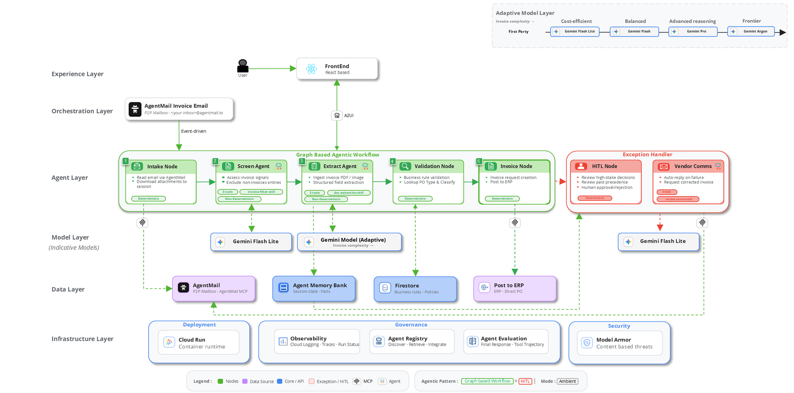

# Invio - Graph Based Agentic Workflow

**Accounts Payable automation on Google ADK 2.0.** An invoice email lands in an
[AgentMail](https://agentmail.to) inbox. The agent screens it, reads the PDF with Gemini,
validates it against AP rules, asks a human to approve anything risky, and posts the result.
Duplicates are escalated.

> **The AI reads; rules and people decide.** Gemini proposes structured data, deterministic
> Python rules route it, and a human approves anything flagged or above the auto-approval limit.
> The agent never authorises a payment.

[Why](#why-this-use-case) · [Architecture](#architecture) · [Test on Cloud Run](#test-it-on-cloud-run) ·
[Run locally](#run-locally) · [Deploy](#deploy-to-cloud-run)

## Why this use case

Every company pays its vendors, and invoice processing is the heartbeat of procure-to-pay. It
touches cash flow, vendor relationships, audit and working capital all at once. Yet most AP
automation is template-based: it works when the invoice looks exactly as expected and breaks the
moment reality changes (a new vendor, a revised layout, a scanned copy, a missing PO reference).
Every one of those exceptions lands back on an AP specialist's queue.

The easy part is automated and the costly part is still manual. The challenge was never following
the process; it was understanding the document. That is exactly what AI does well, and exactly
where traditional automation stops.

## Why a graph-based workflow

The invoice process follows predefined steps, so there is no need to put an AI model behind every
action. The graph handles the deterministic flow, and the model is invoked only where judgment is
needed: reasoning over ambiguous data, interpreting language, and making open-ended decisions. The
result is predictable, auditable and cost-efficient, while still adapting when an invoice doesn't
match the expected pattern.

## Architecture



*Target-state design; the status table below is the source of truth for what ships today.*

A 22-node ADK graph: 3 LLM agents (screening, extraction, rejection email) and 19 deterministic
nodes. Intake is an AgentMail WebSocket, state lives in Firestore, and the React UI renders
agent-emitted A2UI surfaces.

| Area | Status |
|---|---|
| AgentMail intake, screening, extraction, rules, duplicate detection, human approval, rejection emails | Live |
| Model Armor screening, Agent Memory | Live |
| ERP posting | **Stub**: written to Firestore `posted_invoices` |
| ServiceNow duplicate ticket | **Stub**: synthetic ticket id |
| PO ledger | Seeded mock data |

## Test it on Cloud Run

Open the deployed app, email an invoice to the agent, and watch it route live.

1. **Open the app:** `https://invio-invoice-processing-agent-demo-xxxxxxxxxx-uw.a.run.app` (sample URL;
   use your own). Keep the tab open: the browser starts each run when an email arrives.
2. **Email an invoice:** attach a PDF from [`sample invoices/`](sample%20invoices/) and send it to
   `<your-inbox>@agentmail.to` with an invoice-style subject, e.g. *Invoice INV-2026-0301*.
3. **Watch it run:** screening, extraction, validation and routing light up in turn.
4. **Decide:** invoices over $4,000 or with flags pause for you. Read the briefing, then
   *Approve & post* or *Reject & notify vendor*.

| Scenario | Total | File in `sample invoices/` | Outcome |
|---|---|---|---|
| Clean, under the limit | $3,250 | [`01_Invoice_Auto-Approved_Posts-to-SAP.pdf`](sample%20invoices/01_Invoice_Auto-Approved_Posts-to-SAP.pdf) | Posts straight to ERP |
| Over the approval limit | $4,750 | [`02_Invoice_Over-Limit_Human-Approval.pdf`](sample%20invoices/02_Invoice_Over-Limit_Human-Approval.pdf) | Human review; approve to post |
| Missing PO number | $2,750 | [`03_Invoice_Missing-PO_Rejected.pdf`](sample%20invoices/03_Invoice_Missing-PO_Rejected.pdf) | Human review; reject to email the vendor |
| Already-booked invoice | $5,400 | [`04_Invoice_Duplicate_Escalated-ServiceNow.pdf`](sample%20invoices/04_Invoice_Duplicate_Escalated-ServiceNow.pdf) | Escalated with a ServiceNow ticket |
| Prompt injection in the PDF | $3,250 | [`05_Invoice_Prompt-Injection_Blocked-by-Model-Armor.pdf`](sample%20invoices/05_Invoice_Prompt-Injection_Blocked-by-Model-Armor.pdf) | Quarantined by Model Armor before any model reads it (needs `MODEL_ARMOR_ENABLED=true`) |

The vendor, PO number and total on invoices 01 and 02 match a document in the Firestore
`purchase_orders` collection, so the PO check passes. Invoices 03 to 05 are built to fail. A posted
invoice is single-use: resending the same file is treated as a duplicate. Posting to ERP and the
ServiceNow ticket are stubs (recorded in Firestore).

## Run locally

**You need:** [uv](https://docs.astral.sh/uv/) with Python 3.11–3.13, Node 20, `gcloud`, a GCP
project with billing, and an AgentMail inbox.

```bash
gcloud auth application-default login
cp .env.example .env     # set the four values below
uv sync
uv run python deployment/seed_firestore.py --project <your-gcp-project-id>   # once; safe to re-run

uv run --env-file .env uvicorn app.fast_api_app:app --port 8000   # backend
cd frontend && npm install && npm run dev                          # UI on :5173, second terminal
```

| `.env` variable | Value |
|---|---|
| `GCP_PROJECT_ID` | `<your-gcp-project-id>` |
| `AGENTMAIL_INBOX_ID` | `<your-inbox>@agentmail.to` |
| `AGENTMAIL_API_KEY` | `<your-agentmail-api-key>` |
| `VENDOR_FALLBACK_EMAIL` | An address you control (receives rejection drafts) |

Open <http://localhost:5173> and email an invoice to your inbox; the run starts automatically.
Everything else is optional: see [`ENV_SETUP.md`](ENV_SETUP.md). No Firestore? Set
`CONFIG_SOURCE=local`.

**Run the tests:** `uv run pytest tests/unit` (offline), then `cd frontend && npm run typecheck && npm test`.

## Deploy to Cloud Run

```bash
export GCP_PROJECT_ID=<your-gcp-project-id>
export AGENTMAIL_INBOX_ID=<your-inbox>@agentmail.to
export AGENTMAIL_API_KEY=<your-agentmail-api-key>

bash deployment/deploy-infra.sh                                    # first time: APIs, service account, Firestore, service
uv run python deployment/seed_firestore.py --project "$GCP_PROJECT_ID"
bash deployment/deploy.sh                                          # later: rebuild and redeploy
```

Region is `us-west1`; the service is `invio-invoice-processing-agent-demo` (change both at the top of the
scripts). Intake is a long-lived WebSocket, so the service must keep one instance warm and never
scale to zero (the scripts set this). Opt into security features with
`MODEL_ARMOR_ENABLED=true PII_MASKING_ENABLED=true bash deployment/deploy.sh`.

**Verify the deployment:**

```bash
SERVICE_URL=$(gcloud run services describe invio-invoice-processing-agent-demo \
  --region us-west1 --format 'value(status.url)')     # https://<your-cloud-run-service-url>
curl "$SERVICE_URL/intake/status"                      # AgentMail listener connected?
```

Then [test it](#test-it-on-cloud-run) with a sample invoice. Logs:
`gcloud run services logs read invio-invoice-processing-agent-demo --region us-west1`. Set
`AGENT_CARD_URL=$SERVICE_URL/a2a/app` so the A2A agent card advertises the real URL.

## Built with

- **AI & agents:** Gemini on Vertex AI (3.5 Flash-Lite, 3.8 Flash, 3.1 Pro, picked per document by
  complexity), ADK 2.0, A2UI, Vertex AI Memory Bank, AgentMail MCP, Model Armor, `agents-cli eval`
- **Application:** Python 3.12, FastAPI, Pydantic, pypdf; React 19, TypeScript, Vite, Tailwind v4
- **Cloud & ops:** Cloud Run, Cloud Build, Firestore, Secret Manager, OpenTelemetry, Cloud Trace

## Roadmap

- **Three-way match:** verify quantity and price against PO lines and goods receipts, beyond
  today's PO-level checks.
- **Live ERP and spend-management integration:** replace the ERP and ServiceNow stubs, with
  ERP-based duplicate checks.
- **Non-PO invoice policy:** approval rules for utilities, telecom and other invoices with no PO.
- **Agent gateway:** route agent and tool calls through a central gateway for access control,
  policy enforcement and audit.
- **Production hardening:** retries, dead-letter handling and scoped service accounts, plus
  accuracy validation on real invoices.

## More

[`ENV_SETUP.md`](ENV_SETUP.md) (all settings, Firestore policies, Model Armor) ·
[`frontend/README.md`](frontend/README.md) · [`CLAUDE.md`](CLAUDE.md)
